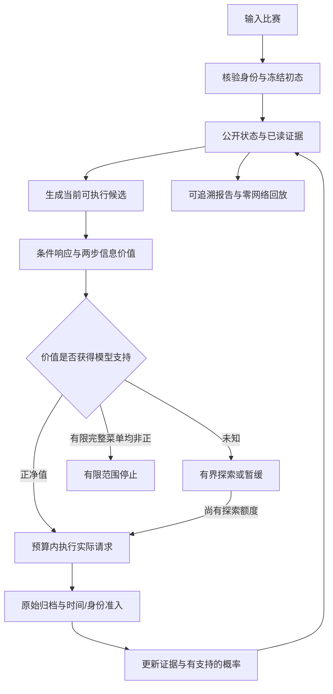

# FootballMind：开放信息环境下基于条件信息价值的自主获取与停止 Agent

**交付定位：足球场景的可回放研究原型。** 本材料面向通用算法创新赛项目陈述，不对应某个尚未明确的 AIC 赛事规则、评分标准或提交要求。证据截至 Round181 封版所引用的归档；比赛是否后来结束，不会自动改变已冻结的待结算状态。

## 项目摘要

用户输入一场比赛，系统自行生成候选信息、判断是否值得获取、调用来源，并在读取实际返回后重新决定下一步。研究对象是有获取成本、信息不完整、候选集合随观察变化的序贯决策。FootballMind 使用条件正文响应模型估计查询前的信息价值，以同一模型更新实际查询后的概率；进一步学习发现页面可能带来的后续候选，用受预算约束的两步价值处理“页面本身不改变判断，却能引出有用正文”的情况。支持不足的价值保持未知。

当前完成了合成环境中的机制验证、真实历史数据上的比较，以及三场真实赛前的身份核验、正文获取、内容衍生查询和精确回放。合成结果支持条件选择与选择性停止；历史比较保留单请求预算下的微小纯损失改善，也保留主预算下的负结果。真实赛前策略仍是未知价值下的有限探索，概率没有改变，也没有取得独立赛果标签。交付可以用于复现实验和体验后端行为，尚不构成真实开放新闻 VoI 收益的证明。

## 科学问题与研究对象

给定当前可见状态，Agent 应该获取哪条尚未读过的信息、是否值得支付获取成本，以及何时停止或暂缓？更具体地说，当一次请求既可能提供内容，也可能改变后续可获取的信息集合时，如何同时估计其直接收益与发现收益？

足球提供了自然的情境差异：“提前出线”可能引起轮换，也可能没有；“平局足以晋级”可能改变战术选择。它们是需要证据支持的情境假设，不是 `提前出线 → 实力下降` 之类固定规则。模型应学习同一种查询在不同已知状态下是否有用。单场比分不能倒推出赛前某次查询是否有价值。

预测对象暂定为常规时间主胜、平局、客胜。主要决策是获取信息和停止，评价目标是概率预测损失与获取成本。项目未在本版定义投资组合、医疗处置或投注收益函数，也未进行这些领域的迁移实验。

## 已实现架构

用户不需要指定“查询伤病还是天气”。来源范围、预算和模型版本属于部署配置。实际执行的请求必须来自当前候选；规划中的未知请求类不能直接变成执行 URL。

本版经过验收的核心控制路径由数值策略、确定性候选生成器和工具运行器组成。LLM 可作为未来的候选提议或解释接口，但本版真实轨迹没有证明 LLM 能自主完成广泛语义研究。开发期间的并行代理分工，也不等于产品已经获得多智能体协同收益。

## 方法与贡献

| 研究贡献候选 | 本版实现 | 证据边界 |
|---|---|---|
| 条件于实际获取历史的正文响应与信息价值 | 学习返回分布；已读证据改变下一次查询的估值；实际返回与预查询枚举使用同一冻结模型 | 正文表示为训练期 TF-IDF 与聚类，不是事实理解或语义真实性模型；真实校准未成立 |
| 候选发现的有限后续价值 | 学习返回后的候选请求类分布，将一次后续查询收益与两次查询成本纳入当前选择 | 两步前瞻、请求类近似及明确的菜单假设；没有开放世界最优性证明 |
| 未知价值与实际执行闭环 | 未知、失败、迟到、未准入正文及预算分别记录；返回后重新生成候选和决策；原始字节可回放 | 工程与研究复现贡献；不能仅凭回放正确性证明预测收益 |

VoI、贝叶斯更新、主动特征获取以及工具调用 Agent 已有研究基础。MCP、爬虫数量、模型名称替换、主题词表和代理角色拆分不作为本项目的原创算法贡献。当前可主张的是这些问题上的具体方法实现与可核验研究结果，论文级新颖性仍需更充分的相关工作比较与真实实验支持。

## 数学模型与适用假设

令结果为 \(Y\in\{H,D,A\}\)，初始概率为 \(p_0\)，当前后验为 \(p_t\)，已经实际获得的有序历史为 \(h_t\)，当前候选动作为 \(a\)。正文编码后的返回为 \(z\)。学习的响应模型为

\[
q_\theta(z\mid Y,p_0,a,h_t).
\]

当前返回概率及其后验按同一响应模型计算：

\[
P_\theta(z\mid s_t,a)=\sum_y p_t(y)q_\theta(z\mid y,p_0,a,h_t),\qquad
p_{t+1}(y\mid z,a)=\frac{p_t(y)q_\theta(z\mid y,p_0,a,h_t)}{P_\theta(z\mid s_t,a)}.
\]

该模型是一条按获取顺序条件化的过程，不是已经证明顺序不变的全网页联合分布。实际缺失支持时不伪造后验。失败、空返回和索引发现类别采用给定历史后的结果中性假设；它们仍消耗成本并进入历史。

本版主实验采用 log loss。对于输出当前后验的概率决策，其模型条件期望风险为 \(R(p)=-\sum_y p(y)\log p(y)\)。一步价值为

\[
V_1(a\mid s_t)=R(p_t)-\mathbb E_z[R(p_{t+1})]-c(a).
\]

这里的熵差对应本版所选概率评分目标。它不能直接替代任意实际行动的效用函数；如果改变任务损失，信息价值也须重定义。

发现模型估计 \(g_\phi(M'\mid s_t,a,z)\)，其中 \(M'\) 为该返回可能新增的有限请求类。令 \(K(s',B-c(a))\) 为后续有条件支持且物理预算可行的动作集合，受限两步策略价值为

\[
V_2(a\mid s_t,B)=V_1(a\mid s_t)
 +\mathbb E_{z,M'}\left[\max\left(0,\max_{b\in K(s',B-c(a))}V_1(b\mid s')\right)\right].
\]

空的已支持集合对应此受限子策略选择停止。未知备选保留为 unresolved，不赋予零价值。已支持子策略价值为正可以执行；其值非正而仍有未知项时暂缓。父响应或候选转换分布本身缺少支持时，两步估值仍为未知。该公式评价模型中的有限两步子策略；未知请求类的近似不保证将来具体请求一定有条件支持。滚动重新规划的最终长轨迹价值不等于某一步的 \(V_2\)。

\(c(a)=\sum_u\lambda_u C_u(a)\) 将声明成本转换为损失单位；请求次数等物理预算在各分支单独约束，不能用小权重放宽硬预算。主合成实验的费用为模拟损失额度，不是人民币、美元或已测得的 API 账单。

关键假设必须与公式同时呈现：未知未来请求以冻结训练请求簇近似；候选菜单在给定历史和返回类别后不额外携带赛果信息；子正文核没有进一步条件化于完整菜单身份；现有未尝试候选保留，尚未建模容量限制导致的候选移除；训练与实际场景的响应规律可迁移性没有得到真实验证。代码见 [正文响应模型](../../football_research/acquisition/text_returns.py)、[发现模型](../../football_research/acquisition/discovery_returns.py) 与 [策略接线](../../football_agent/text_voi_policy.py)。

## 已完成实验

### 条件正文价值：合成机制

Round178 使用 900 个训练场景、300 个独立留出场景。同一个伤病查询在两种已读情境下的净值为 +0.356163 和 −0.074882；取得原消息后，设计中的相同转载增量 EVSI 为 0。较高预算下，VoI 平均查询 1.257 次、log loss 0.672146；固定全查 3 次、log loss 0.671697。固定全查的纯预测损失略好，VoI 成本更低。按原始浮点值统计的 779 次负更新全部保留，其中 764 次低于 −1e−12，不把浮点舍入级变化夸大为实质负结果。[完整记录](../../var/parallel/agent/round178/evaluation/report.md)

### 发现后续价值：主合成比较

Round179 使用 960 个训练场景、240 个独立留出场景；五策略、三预算共 3,600 条轨迹，独立留出样本仍为 240。下表为预算 0.095 的共同条件比较，所有策略拥有相同免费上下文、潜在返回、预测器和成本，初始都只看见一个发现动作。

| 策略 | Log loss ↓ | 平均查询次数 ↓ | 平均模拟成本 ↓ | 损失＋成本 ↓ |
|---|---:|---:|---:|---:|
| 不查询 | 1.097995 | 0.000 | 0.000000 | 1.097995 |
| 一步 VoI | 1.097995 | 0.000 | 0.000000 | 1.097995 |
| 两步 VoI | 0.908912 | 0.846 | 0.038208 | 0.947120 |
| 固定发现后顺序读取 | 0.900448 | 1.792 | 0.080417 | 0.980864 |
| 当前菜单内随机获取 | 0.900448 | 1.792 | 0.080417 | 0.980864 |

发现动作的一步净值为 −0.025，在 competitive 情境下两步净值为 +0.248006077562。预算只能支付一次发现时，不启动查询链；正文已可直接读取时，选择直接读取。这里的固定与随机策略等价，源于一个初始发现动作和两个相同转载的设计，不能据此证明广泛的多工具排名能力。[全部预算与机制检查](../../var/parallel/agent/round179/evaluation/final-request-class/report.md)

初版历史 URL 原型受到唯一标识干扰，退化为不足的条件支持；修复为训练请求簇规划后，在同一开发留出集复验。初次及中间失败均保留，未改变数据、种子、成本、预算或支持阈值。这不是新的独立确认实验。

### 真实历史比较：同时保留局部改善与负结果

同一旧开发区 290 场中，在主预算 0.05／最多两次请求下，原严格 VoI 的 log loss 为 1.115840，不查询为 1.080229；后续上下文残差修正达到 1.086871，仍未超过不查询。在 0.03／最多一次请求下，上下文策略的纯 log loss 为 1.079009，略低于不查询的 1.080229；其损失加成本目标为 1.085854，未占优。因此不能概括为所有预算、所有指标都没有改善。

冻结模型后新获取的 50 场历史时间段，修正策略全部不查询，log loss 为 1.090590，与不查询相同。这些数据属于历史重建，赛果来自原提供方，不能称为独立赛前确认。跨轮旧 utility 权重不同；封版重算表保留原报告权重和实际策略权重，避免静默改写旧结果。[全部冻结对照与明确成本口径](../../var/parallel/agent/round181/evidence/experiment-table.md)

### 真实赛前执行：工程闭环

Round180 对同三场官方身份已核实的比赛进行了八次实际请求。克罗地亚－西班牙取得官方正文，生成并执行一条内容衍生查询，该请求失败；苏格兰－斯洛文尼从实际目录链接中读到赛前发布会，同时保留一次青年队文章的无效尝试；哈萨克－法罗群岛只取得通用赛事内容。

三份结构正文不等于三份相关报道：其中两份含目标实质内容，旧主题提取器仅产生一条仍需比赛绑定的球队上下文证据。三场概率未变，查询为未知 VoI 下的有限探索；独立标签在该归档中均 pending，合格真实训练样本为零。来源诊断的 19 次程序 HTTP 与自主运行八次分列。Round179 与 Round180 是同三场，不计作六个独立样本。[实际轨迹与限制](../parallel/status/round180.md)

## 交付与证据入口

本版提交后端代码、冻结模型与配置、原始响应、逐步选择和费用、实验记录、精确回放及中文报告。实机展示优先使用已归档轨迹；历史回放应明确标识，不能伪装为现场联网或重新预测。

- [冻结后端统一入口与离线演示](../agent/backend-release.md)
- [完整冻结实验证据表](../../var/parallel/agent/round181/evidence/experiment-table.md)
- [逐主张证据与限制](../../var/parallel/agent/round181/evidence/claim-table.json)
- [真实比赛接入与准入细节](../agent/verified-prospective-runbook.md)
- [Round179 冻结主实验验收](../../var/parallel/agent/round179/evaluation/final-request-class/acceptance.json)
- [Round180 真实执行总验收](../../var/parallel/agent/round180/acceptance.json)
- [答辩稿与现场问题](defense-script.md)
- [主张与限制清单](claims-and-limitations.md)

研究成熟度标识保持 `aic_research_claim_ready=false`、`open_world_policy_benefit_proven=false`。完成后端交付与研究材料，不会自动将这两个状态改为 true。

## 相关工作定位

信息价值本身来自成熟的决策分析；Shachter 的工作研究其有效计算，因此“引入 VoI”不能单独作为首创主张。[Efficient Value of Information Computation](https://arxiv.org/abs/1301.6739)

Li 与 Oliva 已研究用生成代理模型估计未观测特征关系并进行主动获取。FootballMind 选择研究动态网页候选发现、实际时钟和执行闭环这一具体问题，尚未完成与该方法的同条件实证比较。[Active Feature Acquisition with Generative Surrogate Models](https://proceedings.mlr.press/v139/li21p.html)

ReAct 展示了语言模型交替推理、行动并利用环境反馈的范式。FootballMind 的待验证研究重点是可学习的数值获取价值与停止依据，不能把普通工具循环本身重新包装成算法创新；本版未报告与 ReAct 的公平对照结果。[ReAct: Synergizing Reasoning and Acting in Language Models](https://arxiv.org/abs/2210.03629)
