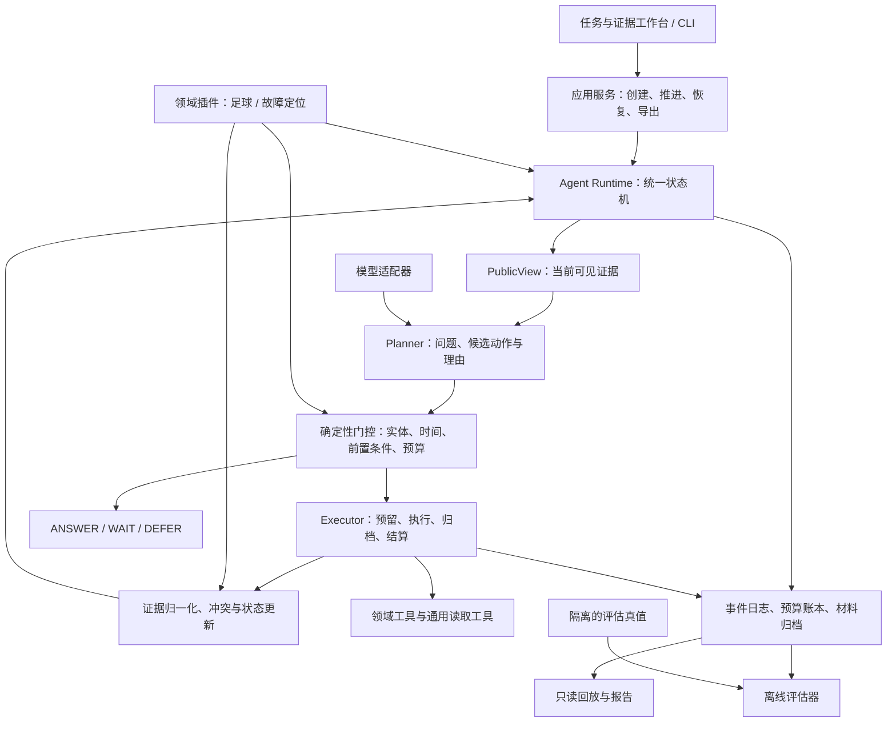
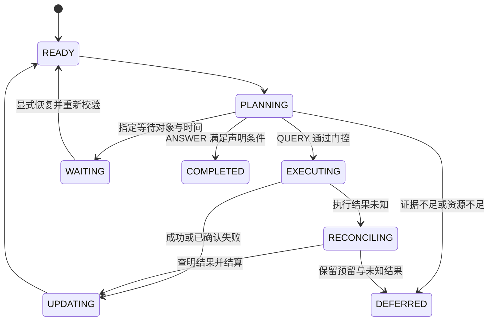

# 自主取证与决策框架：改造架构

设计日期：2026-09-29。状态：待实施设计；本文不是已交付能力说明。

当前产品方向修订：本届参赛版本不以跨领域迁移为主线，先完成 FootballMind 单领域产品化、前端工作台和证据研判验证。本文的通用核心与第二领域内容属于未来扩展设计，具体产品交付以 [FootballMind 项目升级与产品包装规范](../product/footballmind-product-upgrade-spec.md) 为准。

本届范围进一步明确：不实施、不演示、不验收第二领域迁移；只保留足球场景的产品化工作。

暂缓迁移的依据有四点：当前没有企业软件日志、真实第二领域任务和领域标注，受控样例不足以支撑迁移效果结论；可信迁移需要独立任务、冻结版本、公平基线、成本与失败记录，工作量会挤压本届主场景；FootballMind 当前仍需完成前端工作台、证据链、冲突/时效处理、回放和简报导出；一个浅层第二领域案例也不足以推出任意行业通用性。因而本届只验证足球单领域闭环，保留接口边界作为未来扩展基础，不把迁移写成当前能力。

未来扩展定位：面向复杂信息环境的价值感知自主取证与决策智能体框架。若后续取得真实合作数据，再考虑一个 Python 内核、足球研判与第二领域适配器、一个工作台和跨领域实验。

配套文档：agent-framework-roadmap.md（实施与验收）、incident-diagnosis-task-spec.md（第二场景任务）。

## 1. 改造原则

- 渐进抽取现有能力，先保持足球闭环可运行，再验证第二领域。
- 核心共享状态、查询选择、证据更新、预算、执行与回放；领域侧定义实体、证据语义、工具和评价。
- 框架可迁移、运行时可适应、已学习策略可迁移是三个不同结论，分别验证。
- 新领域未标定时使用有界探索；数值 VoI 保持未测，不把模型自评分当作校准价值。
- 第一版用单进程模块化 Python，沿用本地归档和单写者控制。

## 2. 产品范围

足球场景为体育编辑和研究人员生成赛前证据简报；现有数值预测保留独立输入与模型版本。故障定位场景通过日志、健康状态、配置摘要和部署变更，输出有证据的根因候选和待核实事项。首版诊断工具只读，自动修复另立范围。

复杂信息环境落实为六类测试条件：信息缺失、证据冲突、时间失效、工具失败、查询前置依赖、预算约束。首版先做深两个领域。

## 3. 现有实现的复用边界

| 当前模块 | 去向与约束 |
|---|---|
| football_agent/state_query_contract.py | 抽取状态和候选协议；移除默认 match 语义，运行时证据与 evaluator 标签分型 |
| football_agent/context_query_readiness.py | 抽取上下文和前置条件，检查传递依赖 |
| football_agent/query_value_contract.py | 保留 VALUE_UNMEASURED 与范围化停止；补充单位和支持范围 |
| football_agent/contextual_query_gate.py | 复用上下文支持检查；校准数据和损失定义留在领域侧 |
| football_agent/inquiry.py | 真实调查闭环的迁移起点，先做兼容桥，再逐层抽取 |
| inquiry_contract.py / inquiry_hypotheses.py | 引文机制可共享；足球类型、提示词和最低证据要求进入领域适配器 |
| inquiry_continuation.py | 对照当前代码和测试核对续查能力，避免按旧文档重做 WAIT |
| football_agent/audit.py 及归档/传输模块 | 复用 RunStore、事件和收据；旧档案及哈希保持原样 |
| autonomous_context_loop.py | 最新版已有累计声明成本、decision_provider/execute 回调和公开投影；保留 fixture 模式，下一步对齐实际收据与通用执行协议 |
| football_research / football_platform / football_spider | 经足球插件与离线评估接入，不整体迁入核心 |
| demo | 渐进改成任务与证据工作台，页面状态来自真实后端 |

Round81/82 包含真实比赛种子与合成上下文返回，须和已有真实开放调查分开报告。历史评估不替代第二领域独立验证。当前根目录的 git status 返回非 Git 仓库，迁移前建立可恢复基线和版本记录。

## 4. 目标架构



依赖方向：应用层组装核心与插件；插件实现核心协议；核心不导入足球包、故障样例或评估标签。执行器通过注入的注册表调用工具。第一版不新增消息队列、微服务集群或独立向量数据库。

## 5. 核心与领域适配器

核心负责 TaskSpec、公开状态、问题/假设、候选动作、执行合法性、证据关系、预算、恢复、停止说明、事件和报告。领域侧负责实体与目标、证据类型、工具、作用域规则、结论判据及可选损失模型。

以下是待实现的协议设计，并非当前已有 API：

| 接口 | 输入与输出 | 边界 |
|---|---|---|
| task_schema / validate_task | 用户任务 → 校验后的 TaskSpec | 领域目标、实体、来源和时间要求 |
| initial_state | TaskSpec → 初始公开问题/上下文 | 不读取隐藏根因、赛果或未来日志 |
| tool_specs | 领域配置 → 类型化工具定义 | 参数、作用域、前置条件、超时及成本能力 |
| normalize_observation | 原始工具结果 → EvidenceItem | 保留来源、原文定位、时间和错误收据 |
| check_evidence | 问题与证据 → 适用性检查 | 匹配领域类型与作用域；语义核验状态另列 |
| assess_sufficiency | 公开状态 → 充分性检查和未决问题 | 返回可审计规则，不制造置信度 |
| render_decision | 决策与证据引用 → 领域报告 | 统一证据、费用和未知字段 |
| value_model（可选） | 状态与候选 → ValueAssessment | 数据版本、适用范围、效用单位；缺省为未测量 |

领域适配器可提供问题模板与候选构造规则，实际查询顺序由返回信息驱动。避免在适配器中藏一套固定完整流程，再把它描述为同核自主规划。

DomainEvaluator 是独立的离线接口，可读取封存真值并计算领域指标；它不属于运行时 DomainAdapter，不注入 Planner。

## 6. 数据契约

| 对象 | 必要信息 |
|---|---|
| TaskSpec | task_id、domain_id/version、objective、subject_ids、信息截止、执行截止、资源上限、允许工具和来源 |
| AgentState | 问题/假设、可见证据、冲突、候选/已执行动作、资源摘要、运行状态、决策版本 |
| Question / Hypothesis | 命题、实体、作用域、待解决变量、依赖、状态；运行时推断与 evaluator 标签分型 |
| ActionCandidate | action_id、tool_id/version、参数、目标问题、前置条件、预期答案分支、估计资源、理由 |
| EvidenceItem | source_id、材料哈希和原文定位、提取表述、实体/作用域、证据类型、核验状态、时间、来源类型 |
| ValueAssessment | 未测/假设模型/校准支持状态、支持范围、效用单位、估计与不确定性、校准版本 |
| ExecutionReceipt | execution_key、attempt_id、参数摘要、结果引用、耗时、请求数、usage、已报告费用、未知费用、错误 |
| DecisionRecord | 结论或暂缓、支持/反对证据、未决问题、范围化停止原因、累计资源、版本与父运行 |

时间至少区分事件发生、来源发布、系统观察、处理后可用；缺失时间保留未知。实际赛前实验要求证据在截止前确实可用，事后重建单列模式。

证据的原文锚点、实体/作用域、来源断言、系统推断和人工核验分层记录。引文存在不等于事实正确，也不等于模型正确解释了引文。

provenance 按观察或步骤记录：真实在线来源、受控环境真实执行、真实档案回放、合成返回。运行可以标记为混合来源；不用一个 real 布尔值覆盖整条链路。

## 7. 自主循环与状态机

一次循环为：公开状态 → 提出未知和候选动作 → 前置条件/时间/实体门控 → 选择策略 → 预算预留 → 工具执行 → 归档与结算 → 证据更新 → 重规划。

LLM 提议动作，运行时校验执行资格。工作台展示可审计理由与证据变化，不依赖模型内部思考过程作为效果证据。



STOP 映射为停止原因和终态，不能自动等同于成功回答。WAIT 要有具体原因和最早恢复条件；复用已有显式恢复，自动唤醒按需要追加。父子运行关联到共同预算根。

已确认的工具失败可继续规划；过程崩溃导致的未知结果先核对收据。恢复时不自动重做可能已经执行的操作。取消、执行截止和致命存储错误分别保存终止原因。

## 8. 价值策略与停止边界

统一协议下保留两种策略：

- 有支持的价值估计：领域定义损失、合法返回模型与适用上下文，估计查询带来的期望损失下降，声明校准数据和不确定性。
- 有界探索：开放文本或新领域尚无标定时，依据任务相关性、答案分支、冲突消解、前置依赖和资源约束调查，数值 VoI 为空。

当前自主上下文循环的动态策略仍受 QueryValueGate 一致性检查约束。统一运行时应把共同的可执行性门控和两类选择策略分离；不要让开放探索通过虚构数值去满足有限模型门控。

VALUE_UNMEASURED 不转成 0；LLM 优先级不命名为校准 VoI。已声明有限模型和实证校准也分别标记。

质量损失、人民币/美元费用和秒数不能直接相减。先做各资源上限检查；需要效用扣成本时，使用开发集预先确定的权重/换算并记录单位。没有可信换算时展示质量—成本曲线。

有限模型的非正净价值停止，只覆盖已声明模型与候选集合。开放世界停止明确尚未覆盖的来源和未测价值，不宣称全局最优。

## 9. 预算、失败与存储

最新上下文循环已经按每次尝试扣减声明成本，并开放 decision_provider 和 execute 回调。后续是在此基础上统一账本和真实收据，不重复修复已经完成的累计扣减。

资源分别核算：工具调用、HTTP 尝试、LLM 调用、可报告 tokens、已知货币费用、耗时。费用未知保持未知；声明成本、credits 与实际账单不混用。

- 可用资源 = 上限 − 已结算使用 − 未决预留；每类资源独立计算。
- 执行前原子保存意图和预留，执行后按收据结算；失败与重试记录实际消耗。
- 严格货币上限仅适用于价格和调用消耗上界可确定的服务。未定价服务以调用数/时间限额运行并显示费用未知，或暂缓该动作。
- 未知结果保留预留，先核对收据，不自动重试。
- execution_key 用于本地去重；外部服务未支持幂等时，不承诺跨网络恰好执行一次。
- WAIT、恢复和父子运行共用预算；绝对执行截止不因重启刷新。
- 超过预估的实际费用记录差异并阻止后续超限动作，不用删除失败记录美化费用。

先复用 RunStore、材料归档和锁，再抽取存储端口。旧事件与内容哈希不改写；新 schema 配版本化只读适配器。确定性回放使用已有工具返回和模型输出，不重新调用外网或模型。

## 10. 目标目录与兼容迁移

以下目录是设计，不在此阶段创建空实现：

```text
evidence_agent/
  contracts/       # task/state/evidence/action/value/decision
  runtime/         # loop/transitions/budget/resume/execution
  planning/        # public_view/candidate_gate/selection
  evidence/        # provenance/temporal/claims/conflicts
  ports/           # domain/tool/model/store 协议
  adapters/        # 通用模型、归档、传输适配
  reporting/       # 报告和回放
domains/
  football/        # 足球任务、规则、工具桥、可选预测服务
  incident/        # 故障任务、诊断工具、证据规则、报告
apps/workbench/    # 渐进接入现有 demo
evaluation/
  harness/         # 统一运行、成本采样、配对比较
  football/        # 足球指标
  incident/        # 根因/证据指标及隔离真值
tests/
  core/
  domain_contracts/
  migration/
  integration/
```

顺序：新增协议与兼容桥 → 一个足球端到端任务 → 抽取纯状态/证据/门控 → 统一运行与账本 → 足球回归 → 核心冻结 → 第二领域。

兼容阶段适配层可桥接 football_agent；最终冻结的核心不应传递依赖足球实现。旧 CLI/demo 委托新接口，研究协议保留版本化后端。数值 AcquisitionWorkflow 以独立策略/服务接入，不为名称统一强行合并数学前提不同的实现。

## 11. 工作台与产品交付

首屏展示：任务目标、当前结论、已知/未知/冲突、下一步动作及理由、原文/日志证据、累计资源、停止原因。技术 JSON 和工程配置放进详情。

用在线来源、受控实验、档案回放、合成演示标识各案例。事件回放停在某一步时，只显示当时可见内容。提供报告导出与可复查证据引用。

足球文本调查先交付证据简报。数值预测保留独立标识，待文本—特征映射完成独立验证后再联合输出概率；当前设计不默认这条映射已经存在。故障场景输出根因候选、证据链和下一项核实建议。

## 12. 迁移验收与范围控制

- 架构复用：记录核心版本、领域适配文件、新增依赖、接入时间；第二域使用同一核心工件。
- 行为适应：任务/模型/预算相同，仅改变一个环境返回，后续调查在预设分支上合理变化。
- 效果验证：未参与开发的新任务，与固定流程和普通工具型 LLM 对比质量、覆盖率、成本。
- 策略迁移：若声称价值模型跨域迁移，单列零样本与再校准实验；架构复用不代替该证据。

核心冻结后如有修改，生成新版本并披露原因；原冻结点与修改后结果分别报告。不得将改过核心的适配说成零核心改动。

本期优先：真实闭环、双领域同核、独立评估、工作台。第三领域、自动修复、多智能体协作、插件商店、云端大规模调度放入后续候选。
