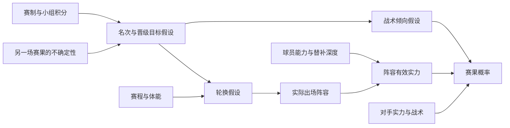

# 第六轮：情境如何改变“下一步值得查询什么”

日期：2026-09-26。研究范围：条件信息获取、赛前证据语义、有限模型内的决策价值。

## 本轮要回答的问题

第五轮每个时间折内初始候选价值向量仅有一种。一个系统即使会更新、收费和停止，如果对同一折的不同比赛始终作同一初始判断，仍没有验证实例级自主信息获取。本轮因此同时推进可见上下文的真实历史消融，以及具有明确假设的赛事情景机制验证。

“提前出线”“可能轮换”“替补较弱”“比赛更难赢”是不同命题。前一个命题可以改变后续查询的优先级，后续命题仍要分别取证。“打平足够”描述赛事目标；防守倾向是战术假设，实际防守行为是另外的观测。低进球、低控球或终场0:0单独都不能识别教练意图。

## 对用户赛例的核验

- **日本—泰国，2026-09-23。** 日本足协赛前资料确认双方已晋级，仍在争小组第一，日本打平即可第一；教练仍以取胜为目标。官网赛程记录终场3:0。可支持“出线不等于名次确定，也不等于放弃争胜”；这里没有用终场比分判断赛前是否值得查询阵容。[JFA赛前说明](https://www.jfa.jp/national_team/u21_2026/asiangames_2026_men/preview_03.html)、[JFA赛程入口](https://www.jfa.jp/national_team/u21_2026/asiangames_2026_men/schedule_result/)、[JFA官网结果记录](https://www.jfa.jp/)。
- **中国—阿联酋，2026-09-23。** 新华社现场报道记载赛前中国、伊朗均积4分，中国打平确保晋级；最终小组第一还受到朝鲜击败伊朗的影响。报道描述中国延续5-3-2阵容、稳守反击。[新华社现场报道](https://www.xinhuanet.com/20260923/e82737698beb439d8ec4abe8d07d8cff/c.html)。体育总局转载的比赛分析也区分了确保出线与争取第一，并描述大部分时间深度防守。[体育总局转载报道](https://www.sport.gov.cn/n4/n30039867/n30039941/c30068821/content.html)。

这些网页于本轮赛后检索，**没有进入历史赛前特征表**。JFA预览的赛前内容与索引日期支持赛前发表的解释，但本地尚无当时采集的不可变快照。新华社和体育总局赛后报道仅用于核验赛例与设计研究问题，绝不反填成当时可见信息。关于实际主力轮换程度、替补实力和原因的额外结论仍需阵容与独立实力证据。

## 状态表示与假设

令已获取证据为 E，免费且合法可见上下文为 C。球队目标、轮换程度、阵容有效实力、战术倾向为不同潜在状态 theta。概率预测应对尚未确认的状态求和，而非将语言推断视为确定事实：

```text
p(Y | E,C) = sum_theta p(Y | theta,E,C) p(theta | E,C)
```

可作为研究假设的依赖关系如下；边不表示已识别的因果效应：



平台分别保存 `qualification` 与 `rank_objective`。争取第一与保证晋级的条件分开；涉及其他场次的结论保留依赖，不预先填入尚未发生的结果。`rotation`、`lineup`、`tactical_intent` 各自保留 unknown / hypothesis / verified_fact / conflicting。真实官宣可核实阵容，教练表态可以核实“说过什么”，并不把未来战术意图变成已发生的事实。

## 获取前计算价值，而不是赛后讲故事

对目标Y和损失函数L，停止时的Bayes风险为：

```text
R(E,C) = min_d E[L(d,Y) | E,C]
EVSI(q | E,C) = R(E,C) - E_z[R(E union {q:z}, C) | E,C,q]
NetValue(q) = EVSI(q) - lambda * cost(q)
```

其中 z 是查询尚未返回时的所有可能观测，积分所需分布必须另行学习、校准或明确声明为模型假设。不得看到阵容结果后才声称事前知道它的价值。成本必须折算到和损失一致的单位，所谓“误差10%、成本2%”在没有尺度定义时没有可加减的数学含义。

在正确有限后验模型和对数评分下，未扣成本的EVSI等于关于赛果Y的条件互信息。降低无关新闻或潜变量的熵，未必降低Y的预测风险；减少预测风险也不要求最大概率类别发生变化。一个新的信息源可能使预测几乎不变，但如果在查询前存在很可能改变判断的其他返回值，查询仍可能具有正期望价值。

固定、失配或训练不充分的预测器，其经验OOF损失差可以为负；这是本轮真实历史估计器的目标，与模型内非负的理想EVSI分开报告。单场赢输仅提供一个随机损失样本，既不证明这条信息有用，也不证明无用。

## 停止要与规划深度一致

```text
J_0(E,b) = R(E)
J_h(E,b) = min( R(E),
                min_affordable_q { cost(q) + E_z J_(h-1)(E union {q:z}, b-cost(q)) } )
```

先查便宜赛制或确认哪一种阵容信息缺失，可能主要帮助选择第二个工具。即使所有一步净收益都非正，也不能据此排除两步组合有收益。本轮提供完整离散观测求和的一步与两步参考解；两步停止只是给定模型和两步规划内的判断。它不同于第五轮只更新mask、保持当前预测的有限近似，也没有解决一般开放环境的完整POMDP。

等待官宣也有价值，但赛前24小时和赛前1小时不是同一信息集。当前历史实验固定赛前24小时；尚未到发布时间的首发不作为可获取证据。未来若增加wait动作，需要重新定义时钟、机会成本、预算和比较策略。

## 实验与证据等级

1. **真实历史消融。** 相同760场输入、相同290场已探索测试比赛、相同前向OOF标签与预测器，对比无上下文、仅当前预测、合法可见内容。球队ID可以表示训练历史关联，不能解释为学到了战意。字典、标准化与系数均在训练内确定；未知球队回退要报告。已购实际数值可用，未购Elo/xG等不进入免费上下文。保持四档预算、验证集选成本权重、测试集只评分。
2. **构造机制检验。** 人工设定的先验、观测似然、赛果条件分布全部随manifest保存。验证未知阵容值得查、强替补下查询价值低、平局目标并不确定战术、无关高熵新闻零目标价值、同源重复报告不重复增信、负的一步净值可能有正的两步价值。结果只验证算法在这些假设下的数学行为。
3. **尚待收集的真实杯赛证据。** 包含赛前积分/同分规则、首名/晋级条件、公布时间明确的首发、实际变化球员与赛前球员实力估计、赛程负荷、战术证据及来源。当前英超导出缺少这一组字段，因此杯赛语义与真实历史消融本轮分开验收。

配对比较按独立比赛/UTC周进行；重复mask、动作或种子不增加独立样本量。候选值在不同比赛间变化属于表达能力验收，损失和费用是否改善属于实证效果，二者不能互相替代。测试赛季已经反复被检查，本轮维持探索性标注。

还有一个需要单独控制的因素：当前空mask预测器仍只给同折基础先验。免费球队上下文如果也给基础预测器，直接改善预测可能解释一部分表面上的获取收益。下一次确认性设计应让基础预测器和获取策略拥有同等免费上下文，再比较额外付费信息的边际价值；本轮还没有完成这个识别问题，故不将取得不同查询次序直接称为算法创新的效果证明。

本轮另发现跨季实体映射漂移：两季实际共同17队中，7队的同一Understat原生ID对应不同导出内部UUID，EPL也发生类似变化。修正限于值模型的公开身份视图，精确连接provider/entity_type/source_id，不按名称相似度推断，不修改原始导出、冻结预测器或OOF增益标签。修正前消融保留为v2，修正后单独报告v3敏感性；历史映射来自事后重建登记表，其可用性不冒充过去真实采集记录。

## 文献位置与下一步值得投入的差异

动态特征选择早已按样本选择查询，并以条件互信息作为依据。Covert等（ICML 2023）研究动态特征获取；Gadgil等（ICLR 2024）直接估计CMI，并讨论不同成本、预算和先验。因此“加上VoI”“按场选特征”本身不是足够的原创主张。[ICML 2023](https://proceedings.mlr.press/v202/covert23a.html)、[ICLR 2024](https://proceedings.iclr.cc/paper_files/paper/2024/hash/9682490bedc064aba8aac1ab3f703507-Abstract-Conference.html)。

2026年的预印本已探索让LLM提供结构化领域知识、把顺序规划交给独立模型。这进一步限制了“LLM负责知识、数学模块负责获取”的单独新颖性；该预印本的结果不直接证明足球迁移效果。[Zero-Shot Active Feature Acquisition via LLM-Elicitation, arXiv v2](https://arxiv.org/abs/2606.18933v2)。

时变AFA的离线评估还依赖采集行为与缺失机制的条件。已有研究明确讨论无直接影响、无未观测混杂和支持度要求。本项目的冻结全量受控揭示实验不等于真实选择性日志的离线策略评估。[JMLR 2025](https://www.jmlr.org/papers/v26/23-1635.html)。

值得继续检验的较具体问题是：**在目标条件发生变化、工具证据相关且具有发布时间限制的环境中，如何用可校准的条件收益和短程组合价值，决定先核实哪一条假设，以及何时停止。** 出线/名次条件可作为一种外部上下文变化；阵容和战术是待证实的中间变量。先建立这类变化的真实数据和失败对照，再判断能否形成区别于现有AFA的算法贡献。增加模块名或更多Agent不替代这一证据。
