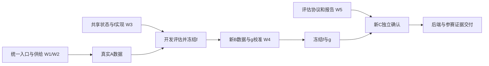

# FootballMind 后续完整执行计划

> 历史计划，已于2026年10月8日停止作为当前执行依据。后续统一执行 [单场开放信息决策计划](footballmind-delivery-plan.md)。用户明确以一场比赛中的开放信息 VoI 为参赛核心，允许预配置身份和来源，不要求商业覆盖。下方通用入口、前瞻 A/B/C 等待及历史目录主体验的不同阶段安排仅保留为沿革，不能覆盖新计划。

## 2026-10-07 截止日期调整：本节优先于下方原研究分期

用户明确提交日为 **2026-10-15**，并要求预留几天人工测试。首个提交版本按“算法机制可运行、用户只输入比赛、历史数据可复用、缺失来源跳过”验收。**未来 A/B/C 赛果、全量新文本训练和显著预测优势不再是提交前置条件。** 下方前瞻研究分期保留为提交后的研究计划，不继续阻塞本期交付。

### 固定范围

1. 主体验复用已有真实历史比赛与逐时间折冻结的模型，由系统自动选取对应模型。输入只有比赛；预算为可选参数，不要求用户指定信息主题、特征或来源。
2. 每一步用当前可见信息计算候选期望收益和成本，执行被选动作，更新概率并重新判断；允许不查询、读一次后停止、继续查询。未读信息和最终比分不进入选择器。
3. 缺失返回保留缺失，缺收益模型保留未知，无法匹配的比赛明确告知范围；不能用人为指定的伤停/天气权重填充。历史有限工具菜单和现有开放候选链的能力分别呈现。
4. 核心验证是自主选择、条件更新、成本约束、停止与可复现，使用现有历史数据。成本模拟、历史重建以及构造机制样例均标明，不冒充当年实时采集或预测优势。
5. 本期不新增前端、不等待未来比赛、不扩模型家族、不以多轮边界审计代替可运行交付。旧模型、冻结归档与研究结果保留。

### 日历与交付

| 时间（北京时间） | 交付 | 结束条件 |
| --- | --- | --- |
| 10 月 7—10 日 | 历史比赛主入口、逐步数值选择报告、完整功能检查和操作说明 | 用户能只给比赛运行；支持选择、更新、停止、缺数据分支 |
| 10 月 11—13 日 | 人工测试与反馈修复 | 收集比赛 ID、运行目录和现象；只修主线阻断或错误 |
| 10 月 14 日 | 封版与参赛材料一致性核对 | 命令、案例、算法公式、能力声明与实际产物一致 |
| 10 月 15 日 | 提交 | 不在最后一天引入新训练链或新数据依赖 |

可运行入口一旦完成即提前交给用户，不要求等到 10 月 11 日才测试。上述为工作安排，不表示有未声明的后台任务在自动运行。

### 本次集中实施

- 总控：统一 `footballmind` 历史命令与操作文档、取舍、集成与实际运行。
- 历史算法任务：复用 Round177 逐折 ContextualJoint 冻结模型与 290 场历史范围，自动路由比赛、运行原数值 VoI 并生成逐步报告，不重新选参。
- 功能验收任务：按比赛清单跑完整主线，核对可见状态、预算、概率和停止；按实际行为列案例，不按赛果命中挑案例。
- 评审任务：检查有限历史菜单与开放候选能力的界线，避免把数值历史基线误写为已经解决任意开放新闻的估值。

主验收句保持：**用户给比赛，系统决定查什么、是否继续、何时停止；人不替算法指定每场比赛的信息价值。**

---

制定时间：2026-10-07，北京时间。依据：Round192 实际代码、真实数据与验收结果。

本文件统一规定接下来的工作、依赖和验收。它是尚待执行的计划，不是新增能力或实验结果声明；不重置历史十轮承诺。旧研究报告、验收与负结果继续保留，发生范围变化时在本文件说明原因，不再以新的 Round 编号重新开启同一份计划。

## 1. 最终目标与交付边界

用户输入一场比赛。系统完成比赛识别与初态准备，主动发现候选信息，依据当前已知证据估计查询的预期收益，选择获取、更新、继续或停止，输出概率、依据、获取轨迹、成本及能力边界。

用户不需要提出研究问题、选择伤病/天气等主题、填写数据源 URL 或制作身份/模型 JSON。比赛身份有歧义时允许澄清比赛；研究损失、工具能力和预算属于部署配置。自主性指逐场、逐步选择，不意味着无需定义任务与资源约束。

首个可交付范围：公开来源可用、官方比赛身份和结算规则可验证的赛前比赛；有限但可动态扩展的可见候选菜单；市场先验只在实际取得时使用，缺失时保留null，并由已训练且有支持的可选先验预测器采用训练期基准。范围与失败状态明确展示。任意联赛全覆盖、全网最优搜索、跨医疗/金融迁移和新前端均不属于这次收敛交付。

分开验收两种结果：

1. 工程交付：新比赛可以通过统一后台入口运行，日志可追溯，状态可恢复，输出真实反映能力。
2. 研究交付：在独立比赛上检验选择和停止的效果。优势不保证发生；负结果也必须保留，但不能写成创新已经有效。

## 2. 起点：已经具备什么

截至 Round192，有 7 场物理比赛、11 个实际 run、32 条实际响应；6 场、26 条响应通过独立结果与完整历史核验。类别为主胜0、平局2、客胜4；合格 article5条，覆盖3场，存在重复与无关正文。

真实训练报告仍为 not_ready、model=null。真实冻结 f、真实 critic 和独立确认结论尚缺。1204项相关回归及11条真实轨迹精确回放证明实现一致性，不证明信息价值有效。

已具备并复用：原始归档、身份/时间/结果网关、学习阶段登记、候选发现、有限探索、运行预算、正文投影、概率更新/经验价值研究模型、回放及分析报告。最新内容链为 news4 / evidence5 / candidate7，但它没有成为所有入口的默认路径。候选标题上下文已保存，现有 f/critic 尚不消费它。

正式后台仍依赖预先配置的比赛，旧体验启动器不是最新研究链的统一入口。平台 scheduler 主要运行赛程/结果/临场数据任务；登记→正文采集→结算→学习尚需串接。

## 3. 唯一算法主线

保留既有精确/邻域正文核及其风险校准器作为基线。后续仅推进一条新增主线：

**可见上下文共享表示 → 以市场先验为基础的部分信息预测器 f → 同一冻结 f 的实际有符号损失改善 → 条件收益估计器 g → 成本约束的选择与停止。**

LLM或文本编码器可以对已经取得的文本作结构化或编码，不能读取未请求正文、推测隐藏事实后当已知输入，或自行报告“查询预计提高10%”作为数值价值。先使用现有依赖和可重复编码建立小模型；必要的编码器升级单独作一项消融，不能同时展开多个模型家族。

状态 H_t 保存已读证据及可见时间、主体/赛事范围、重复/冲突关系、未知标记、实际有序历史、预测和预算。动作 a 的上下文来自已读父页标签、来源和工具参数，不能来自未读目标正文。

对冻结的 f 和实际返回 o，监督目标为：

```text
delta = log f(H + o)[y] - log f(H)[y]
g(H, a) = E[delta | 查询前可见的 H 和 a]
net_gain = g(H, a) - lambda · expected_cost(H, a)
```

delta 可为负；概率变化、熵下降、读到正文、查询更少均不能代替这个目标。该目标是固定预测器的经验风险改善，不冒充精确 Bayes 最优信息价值。单场 realized delta 不能证明某条信息在总体上有用或无用。

## 4. 工作包与具体做法

### W1：统一新比赛入口和持续数据流程（P0）

**问题：** 当前能运行各段，但新比赛仍需手工准备研究文件，真实样本积累慢。

**实施：**

1. 扩展现有 `football_agent.footballmind`，接受比赛ID，或双方球队+日期；先查询现有比赛库，必要时调用已实现的公开赛程采集。仅身份有多个合理匹配时请用户选择比赛。
2. 复用市场初态与官方身份网关，自动检查报价新鲜度、主客顺序、赛事类别、开球时间和结算范围；缺失时返回具体待定原因。
3. 自动准备已有初始化、身份和学习登记材料。新学习任务显式使用 news4/evidence5/candidate7，原回放按原版本恢复。
4. 将任务写入持久状态：discovered → prepared → registered → collecting → collected → awaiting_result → settled → training_eligible；另外保留 failed/expired/unsupported。每一阶段有最后成功位置和原因。
5. 执行器复用现有锁、任务存储和归档，不另造一个通用调度平台。恢复时先确认已发请求是否有原始回执，避免中断后静默重复扣费或把一次请求改写成两条样本。
6. 赛后结果核验使用预先确定的时点与有限重试预算，不紧密轮询；重试逐次记账。启动和停止作业的命令、状态及输出位置明确记录。
7. 将分析、重放、结果核验、批次统计接到同一入口。历史体验路径保留清晰标记，最终默认后台调用当前研究链。

**主要复用/修改位置：** `football_agent/footballmind.py`、`football_research/data_adapters/prematch_market.py`、`verified_fixtures.py`、`prospective_learning.py`、`prospective_text.py`、现有 scheduler。新任务编排若需模块，保持薄层，业务判断继续调用已有模块。

**验收：** 一场未写入旧部署配置的新比赛，仅通过比赛输入完成准备和采集；一个进程重启后可从已完成阶段继续；不会重新执行已确认完成的HTTP；到期结果自动关联原run；重复run不增加独立比赛数。若研究模型未就绪，报告明确标记探索状态。

### W2：可持续的真实样本与候选覆盖（P0，与W1合并推进）

**实施：**

1. 先做来源能力盘点，选取能持续提供赛程、赛前正文和独立结果的有限赛事范围。若现有范围没有近期赛程，先有界核实一个新范围，再做通用赛事适配，不逐场编写身份补丁。
2. 首次供给试运行预先登记20场连续满足赛前准入条件的新比赛，每场最多4次Actor请求。20场是供给试运行批次，不是统计充分性承诺；Actor请求上限80，身份准备、结果和研究面板请求另行限额和记账。
3. 比赛顺序按预定日期/范围固定。记录全部候选、被拒原因、失败、空页和缺标签；不按新闻内容或已知比分选成功案例。批次不足20场如实报告不足。
4. 同时记录四个层级：独立比赛、取得实质正文的比赛、f能有效更新的比赛、g能估值的决策状态。不能仅报告HTTP成功率。
5. 用已读标题、比赛身份与文本语境学习相关性，保留“单队背景、可能相关、明确其他主体、未知”等可审状态；不能把没有同时出现双方名称的新闻一律删掉。
6. 检查跨站转载和同一模板，用原文及语义关系统计重复；重复可以保留在历史里，但不能算独立事实或独立比赛。
7. 保存所有可见候选及选择概率。有限探索采用预先固定的预算与抽样协议，为后续估值积累覆盖，不伪装成已学习的正VoI。

**检查与转向：** 首批结束先检查正文覆盖、来源集中度、未知原因及每层独立支持。若主要损失仍在正文发现/解析，修复占比最高的一个实际障碍后采下一批；若有正文但条件模型仍普遍UNKNOWN，进入W3的共享表示修正。不得原样重复无效采集，也不得把凑足12场作为停止采样标准。

**验收：** 可重复运行的供给流程、完整批次清单、来源/候选覆盖统计、实际监督数据。必要数量、类别和来源支持均报告，缺口不补造。

### W3：让实际证据进入可泛化的预测器 f（P0，可与W1并行开发）

**实施：**

1. 定义唯一的“决策时可见状态”编码。保存原文、来源、主体范围、捕获/发布时间差、未知发布时间、重复组、相互矛盾的陈述以及有序动作记录；不生成手工“伤病扣分”“提前出线降实力”规则。
2. 区分获取失败、真正无数据和解析未知。失败不会产生虚构证据；解析未知保留原始记录，不当作正文价值为零。修复后的派生物保持新版本和实际可用时间。
3. 在可见信息上做共享表示，避免把“具体URL×精确历史字符串”作为必须完全相同的硬格子。原始有序历史继续保存，模型可学习摘要，不通过删掉失败或冲突伪造较短历史。
4. 首选小型正则化概率残差模型：`p_f(y|H)=softmax(log p0 + delta_theta(phi(H)))`。以市场先验log概率为偏置，以已读内容/语境表示学习修正，零修正严格回到先验。可用现有训练内文本编码建立第一版；编码、归一化和降维均仅在训练段拟合。编码器及预测器一起冻结。同场多个前缀按比赛加权，不扩大独立样本数。
5. 以同一个f预测真实不同前缀，不为每个查询路径重训一个模型；避免正文只有在已知结果下才显得“有解释力”。零内容时保持清楚的先验回退路径。
6. 开发数据按比赛和时间划分，比较市场先验、既有正文核、新共享表示三项。主看log loss、Brier、校准、可支持比例及负更新；同时检查新闻相对市场是否还含增量信息。
7. 候选标题只能以已读取父页的证据进入状态/动作表示；目标文章未读取的内容不能进入编码。若f使用首页标题，该信息必须已经计入点击前的预测，点击后不能重复计收益。新f若确实从目录标题更新概率，变化归于目录的实际返回，不机械继承旧模型“目录即时价值恒零”的假定。任何LLM文本处理都记版本、输入、输出与资源成本；外部模型参数本身不能被当作赛前原始证据。

**验收：** 在真实开发留出中能覆盖明确的一组新比赛/查询状态，概率更新可重复；报告改善、恶化和无变化，并冻结一个可装载的f。是否超越先验按数据结论表述，不以“概率终于会动”验收效果。

**失败转向：** 若无稳定增量信息，先定位主题相关性、市场已吸收信息、时间错位或表示不足；不继续堆更复杂模型。新版本改变支持方法必须单独登记并比较，不能为了六场现有数据而悄悄降低旧门槛。

### W4：学会选取信息、拒绝低价值查询和停止（P0，依赖冻结f及新校准数据）

**实施：**

1. 冻结W3的f后，采集新的校准比赛。内部重放同一个f计算每个实际查询的delta，保留负值；不能把f训练比赛直接改名为独立校准比赛。
2. g只接收查询前可见的当前状态、候选标签、工具/来源、成本和时间特征。以共享状态下的正则化收益回归为主，来源差异作受控收缩，不跨完全无支持的区域自信外推；既有分组校准器保留作对照。
   新g直接拟合固定判别式f的实际风险差，不要求旧生成式模型先枚举出Bayes EVSI。它复用时钟/身份/原始监督检查，采用明确的新模型与策略版本，不能接回旧critic的`enumerate`前置门导致所有新样本再次UNKNOWN。新g自身的支持和未知边界仍必须独立验证。
3. 记录候选选择概率和覆盖。主要训练信号来自明确探索协议；覆盖不充分时不声称能识别所有未选动作价值。离策略评估仅在实际重叠与有效样本支持下使用，不靠巨大逆概率权重制造结论。
4. 验证收益估计的符号、排序与分箱校准，给出经验不确定性/支持状态。估值为未知与估值为零分别表示。描述性区间不冒充严格时序覆盖保证。
5. 资源分别记录请求、时延、tokens、已测费用和未知费用。先报告预算—质量曲线；组合损失中的lambda在确认前固定，同时报告合理范围敏感性，不把百分比误差与费用百分比直接相减。
6. 选择按估计净收益与预先登记的不确定性策略执行；收益未知时只使用显式有限探索，预算不足就诚实结束探索。读取后更新f状态并重估其余动作，包含重复和互补信息。
7. 停止至少分四类：当前可见且有支持的菜单内无正净收益；缺支持无法估值；预算不足；赛前截止。不能从UNKNOWN推出“信息足够”，不能把局部菜单停止写成全网最优停止。
8. 单步路线经验证后，才启用已有有限两步发现模型的小范围对照，处理“先读目录才能发现新闻”“先确认轮换才值得查替补阵容”等互补情况。限制搜索宽度、深度和成本，不重写通用规划器。

**验收：** 新比赛上出现有数值依据的不同查询选择、更新后选择改变，以及能解释的停止；同时有收益/损害与覆盖报告。所有动作都标明是学习选择还是有限探索。多步支持不足时交付明确的一步研究范围，不宣称多步成立。

### W5：独立评估、统一交付和AIC材料（P1，评估开发立即并行）

**实施：**

1. 在新确认数据进入前冻结任务、来源范围、主要指标、预算、基线、消融和判断规则。基线至少为不查、固定顺序、随机、原VoI方法、新方法；有受控有限面板时增加全读。可用真实LLM配置时另加纯LLM选工具，缺配置不冒充已做。
2. 同一比较使用同一个f、相同初态与预算，并区分三种证据：构造机制测试；真实赛前冻结响应面板的有限回放；实际在线采集。三者不得混成一个“真实效果”数字。
3. 未选响应不可凭空获知。有限面板由评估侧按预定范围采集，费用单记，Actor只能逐步看已选择返回。动态发现的链接只能在父页读取后进入菜单。不能把该面板称为全网反事实或证明任意在线策略收益。
4. 独立确认至少报告log loss/Brier、成本、延迟、查询次数、估值覆盖、选择/停止原因，以及误查有害信息、漏查有益信息的可识别部分。统计以比赛或时间块为单位，不以页面行数扩样本。C的样本量/结束规则依据A/B方差与最小有意义改善事先制定，不能按C结果好坏临时停止；只有实际轨迹、缺乏共同面板时，采用前瞻策略分配而不补造未读响应。
5. 关键消融只保留与主张直接相关的项目：有/无读前标签；有/无重复与时效语境；有/无收益估计；单步/有限两步。开发段可以选择模型；确认段不再调参。
6. 平均收益、区间、失败分组一起呈现。若没有优势，发布带边界的研究原型和负结果；后续新研究必须使用新的确认期。
7. 后台报告展示概率变化、已读依据、每步选择理由/支持/成本与停止原因，不要求用户自己提出信息问题。提供稳定命令、运行配置、安装和恢复说明、真实案例回放。
8. 更新既有AIC brief、答辩稿、主张与限制表。技术贡献必须落到已验证的机制差异；不能把MCP、多Agent分工或VoI概念本身称为新算法。比赛具体规则/格式/截止时间由正式材料核实后适配。

**验收：** 同一入口能运行新比赛与回放案例；冻结评估可复现；图表、数据版本和主张一致。展示至少覆盖：有支持的值得查、当前菜单不值得查、重复/矛盾需核验、预算或支持不足结束。只有实际发生的案例标为真实；机制样例单独标注。

## 5. 数据分期及真正的依赖

| 数据阶段 | 用途 | 冻结/隔离要求 |
|---|---|---|
| A：开发/训练 | 编码与f开发、超参数选择、供给诊断 | 内部按时间划分训练/开发验证；同场和重复文本关系可审；不作为最终确认 |
| B：收益学习/校准 | 冻结f后的真实查询、g训练与开发验证 | 新比赛；f在实际查询之前冻结；g的拟合和诊断子集划分预先声明 |
| C：独立确认 | 固定f与g和对照策略的效果检验 | 更晚新比赛；指标与预算先定；结果出现后不调参重称确认 |

截至Round202的19场均已暴露为f训练身份A，不能事后划成真实前瞻B/C。历史资料可用于解析开发或明确标记的历史研究；当前捕获的网页不能冒充当年的赛前快照。



工具接线、状态编码和评估框架可立即并行。真实f训练依赖A数据；可信g学习依赖冻结f及B数据；独立结论依赖C数据。这些数据依赖不能通过多开线程消除。

## 6. 执行分工与合并规则

默认使用总控加最多三个有边界的子任务；没有可独立工作时收回并行，不把每个测试拆成线程。

| 角色 | 负责 | 主要文件边界 |
|---|---|---|
| 总控 | 总入口、接口冻结、计划取舍、合并与验收 | `footballmind.py`、集成配置与本计划 |
| 数据任务 | 新比赛准备、持久任务、来源与赛果接线 | 数据适配器及scheduler；不得改模型训练门槛 |
| 算法任务 | 可见状态表示、f/g、选择与停止 | acquisition及策略模块；不得改真实归档/确认集 |
| 评估任务 | 分期、同条件对照、独立复算与证据报告 | evaluation/必要测试/实验清单；不得替算法调确认分数 |

开工前固定输入输出约定及文件所有权。每个主工作包一次交付“实现+相关测试+实际运行或明确未运行原因+可复核结果”，不把上述环节切成四轮。真实HTTP在总控预定预算内分配，子任务不得各自重复抓同一批材料。

## 7. 里程碑、失败处理与完成定义

| 里程碑 | 必须形成的交付 | 不满足时处理 |
|---|---|---|
| M1：供给闭环 | 新比赛统一入口；一个前瞻批次可登记/采集/待结算/汇总 | 修复具体来源或编排瓶颈；不扩大算法家族 |
| M2：真实f | 可装载冻结f；开发留出覆盖/概率质量报告 | 检查正文/语境/信息增量；数据不足如实停留诊断态 |
| M3：学习型选择 | 冻结g；新比赛的选择与停止轨迹；估值校准与支持报告 | 保留旧基线；定位错误估值/稀疏，限定范围，不硬宣称已学会 |
| M4：独立研究结论 | 新C数据上同条件比较、消融和失败案例 | 优势不足则结论为未建立；不得反复刷新同一确认集 |
| M5：可交付项目 | 单一后台、可复现包、真实演示和一致的答辩材料 | 仅修阻断运行或主张不一致的问题 |

不承诺再开若干轮后必然取得研究优势。工程工作持续自主推进；实际比赛开赛、结果和独立样本数量是外部依赖，单列报告。没有真实数据时可以完成实现与机制验证，但不标记M2/M3/M4效果已完成。

每次向用户汇报固定五项：本次完成的主交付；实际运行结果；独立样本与支持变化；仍未成立的主张；下一件最高收益工作。主要进度不采用Round数量、代码量或测试数量。

## 8. 用户协助与当前不展开的事项

现有授权足够继续公开来源、后端开发、必要并行和可逆修改，无需逐步确认。以下情况再向用户问明确问题：付费/私有接口及费用上限、无法自动区分的比赛身份、重大研究范围变化、具体AIC赛事官方要求。不给算法硬填不确定答案。

当前不展开新前端、全联赛爬虫扩张、大模型微调、多模型刷榜、大量Agent角色拆分、跨领域演示或为了局部通过反复新建协议。来源适配仅服务连续真实数据供给，测试仅服务本次改变与必要回归。

## 9. 当前落地与下一主任务（更新至 Round203；以下保留阶段沿革）

上述首次动作已有实现：统一后台持久作业已运行新比赛；可见上下文预测器 f、条件收益估计器 g、B/C 正式登记与 collector 及精确回放均已实现。构造机制完成不代替真实 f/g 训练和独立策略结论。接下来不重新开始上述首次动作。

Round198 新增官方身份与采集独立于市场初始化的执行分支。身份入口、有限探索、独立结果与恢复闭环已经通过，并实际采集三场新比赛。当前曝光为17 run / 13物理比赛 / 55实际返回，其中新增3场没有市场先验，不能进入现有数值训练契约；原数值链仍14 run / 10物理比赛 / 43返回，有独立标签仍6场。

对首个交付范围作明确补充：市场先验仍是现有数值 f 的输入；它不再是比赛身份和信息采集的前置条件。缺先验分支输出 null 概率与 null VoI，只进行事前有界探索。该状态不满足“概率决策已完成”的验收。

下一最高收益项是让已取得的证据进入可检验的预测和收益学习：

1. 从R198已经保存的原始新闻页验证正文解析。四个日期新闻页缺少现有Article元数据，当前角色unknown；先零网解决已证实的输入障碍，不继续盲采更多相同格式页面。派生修复保留新可用时间，不改写旧Actor轨迹。
2. 明确并验证缺市场输入时的预测契约。现有f基于log市场概率偏置，不能直接吞入null；需要在训练时点前的数据上验证替代初始化/缺失输入方案，然后才能纳入对应证据样本。不得给旧轨迹补造均匀先验、损失改善或VoI。
3. 到期核验已有比赛的独立结果，再按实际类别、正文和时间支持决定真实f冻结。持续保留not_ready与失败；不降低门槛让六场数据强行通过。
4. 真实f冻结后再进入独立B采集与g学习，最终独立C验证选择/停止。当前真实B=0、真实g未拟合、真实C=0。

本次新增3次身份请求和12次Actor请求，0新独立标签。详细能力与未完成项见 `acquisition/round198-official-evidence-without-market-prior.md`。这个更新延续原计划，不重置既有轮次承诺。

Round199已完成前两项输入障碍的实现：四篇原页可派生29段正文并进入可见状态，news6已接入既有collector及未来新任务；可选prior预测器以训练A独立标签频率作缺失输入基准，共享旧拟合内核，对无域支持保留UNKNOWN。v5原轨迹已可独立转换为无prior待标签状态，原35已标注前缀保留，全部待标签状态为49个。新派生正文没有回填旧训练轨迹。详细见 `acquisition/round199-body-and-optional-prior-contract.md`。

接下来不再重复正文或None类型接口建设。优先补齐已登记比赛的独立赛果与真实文本训练支持，按新旧契约分别检查模型就绪；真实f冻结后接独立B和g。可选prior模型尚未在真实在线策略中启用，不以经验base或构造测试冒充学习型查询价值。当前仍6个有标签物理比赛、无主胜类，真实模型仍not_ready。

Round200将news6放入三场新比赛的实际查询，正文首次在缺prior原Actor状态中形成：3场、4个文章返回、3份不同正文、累计25段，均按真实available_at保存。新增官方原档批次规划器按开赛时间/原生ID排除既有曝光，默认7天不变，显式14天研究批次固定于请求前。15次HTTP内完成3身份+12 Actor（8次200、4次302），没有新赛果。当前20run/16物理比赛/67返回、35已标注状态/76待定，独立标签仍6场且无主胜类。

数据支持审计修正了仅等待结算即可训练有效正文模型的预期：原有prior域实际有文本比赛最多6场，无prior域本轮后为6场，其中3场有真实正文；每域仍要求12独立已结算文本比赛及三类覆盖。这是必要下界，不是相关性或效果保证。优先研究无prior单域，不把两域同时达标作为本期前置要求，也不把同文跨比赛返回当作独立信息。

下一主交付明确为缺prior完整B→g→C研究接线，复用已有运行器，避免只改loader：官方身份注册与A/B/C物理隔离、冻结f实际执行、查询前及即时返回后的原档监督、g缺失先验/模型基准表示、冻结f/g的C执行及精确回放。旧7天/市场/v5原档保持。构造闭环先验证接口与科学边界，真实f仍not_ready时不伪装真实B/C已开始。数据侧到期核验既有结果；补新样本先限定新的连续来源范围，不反复重采或继续扩长窗口凑数。详见 `acquisition/round200-actual-body-cohort.md`。

Round201已完成上述缺prior完整B→g→C接线，不再将其列为待开发接口。正式注册/collector、实际f更新、原档即时signed gain、新g输入和支持判断、独立C与回放均已组合运行。构造12场B产生48个实际查询对，g实际拟合；独立C为1次UNKNOWN探索+3次计算正净收益选择，最终预算停止。使用模拟来源和时钟，成本换算权重为0；这不证明真实收益或停止充分性。真实库存仍20run/16物理比赛/67返回，6独立标签、35有标签/76待定，真实f not_ready、A16/B0/C0。

Round201之后的工作转为真实支持形成与验证；R202已补上原档时间开发评估和有限来源扩展。官方group3身份/赛果/连续规划/严格TLS及持久设置已接通，默认7天窗口内3场新A实际采集12次Actor返回，另3次身份和1次研究请求，总16次；三场共41个累计可见正文段落，相关性和收益未知。当前23run/19物理比赛/79返回，35有标签前缀/103待定，仍只有6独立结果（主胜0/平2/客胜4），真实f not_ready，A19/B0/C0。缺prior域9场中6场实际具有正文，均待结果。

新开发入口按训练截止与审计时间分别重建原始结果，保留35条较早标签的可用时间，同场整体按实际决策时间划分；不先拟合全A，也不把待结算前缀作零收益。实际6场训练候选、13场待结算排除，model/summary均null。这是A内部回顾性开发，不是独立C。

**Round202确定的主任务：修正比赛主体与证据的关联表示（下面记录R203完成状态）。** R202构造反例确认当时f/g编码忽略有序主客身份；固定正文、时间、先验和候选时，交换球队或替换无关比赛，输入向量及预测/估值完全不变。实施目标为复用原模型主线，增加经过身份核验的名称与主/客/未知主体关联，以及已读正文和读前候选的角色文本交互，共享给f与g；不手工指定信息主题价值，不读取未取得正文，不只加比赛ID。先检验表示可区分性及原档兼容，再在真实A开发留出检验收益，不能把构造差异等同效果。

供给与算法并行：已有比赛到期再核验；group3剩余3场进入原窗口后连续采集，冠军组未曝光12场保留为f冻结后的B候选。当前有限来源即便全部成功也无剩余独立C，需要另行事前限定未来范围。支持不足不启用真实f/g，登记队列不自动改作B/C。W5同条件比较继续沿原协议执行，不把构造链、查询次数或重复正文充作独立证据。详见 `acquisition/round202-source-scope-and-context-development.md`。

Round203已完成角色共享表示及全链接线：原文核验的规范名称→五个角色文本通道→同固定正则f与条件g→官方注册/实际执行/同f收益/独立C/replay。旧f/g保持基线，角色缺失或无局部支持不补为零价值。两套完整构造链中C各为1次计算正收益、3次UNKNOWN探索，预算停、无充分性证书；B24的名义数量仍不足以覆盖每角色开赛日期及候选邻域，保留限制。单独满足12场/2日期支持的g机制实验出现主客不同且均为负的实际拟合估值，不据此宣称现实收益。

真实A的角色训练和双截止开发评估已完成原档运行，仍23run/19物理/79返回、6标签、35有标签/103待定、A19/B0/C0；本轮0HTTP。正文主客提及支持远低于链接队名覆盖，规范名称提及也不等于指代或战术理解。当前下一重点是可验证主体关联的真实质量（规范名以外别名必须有来源证明）和到期独立标签；支持形成后，在同一A时间开发划分上比较旧表示与角色表示，冻结f后沿已完成接口进入B/g，再独立C。当前f仍not_ready时不继续扩模型家族，不改门槛或重采旧场凑支持。详情见 `acquisition/round203-fixture-role-context.md`。

本计划的核心验收句：**用户给比赛，系统自己决定下一步信息；这个决定由读前可见状态、可检验的预期收益与资源约束驱动，并由独立数据检验。**
